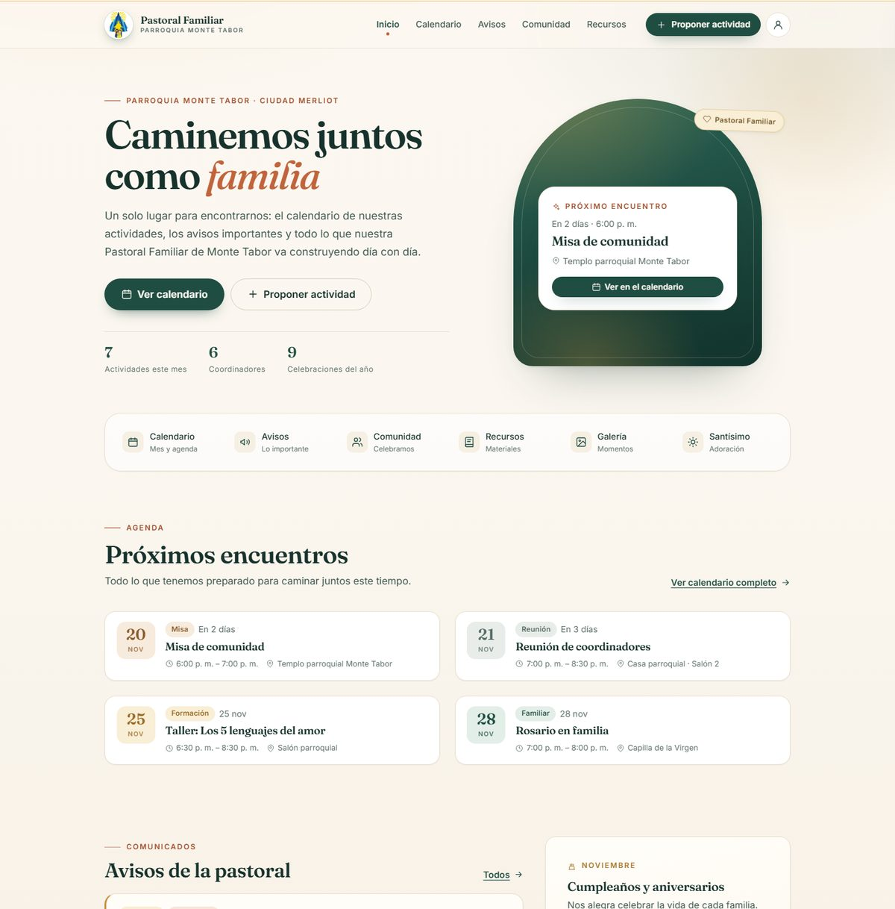
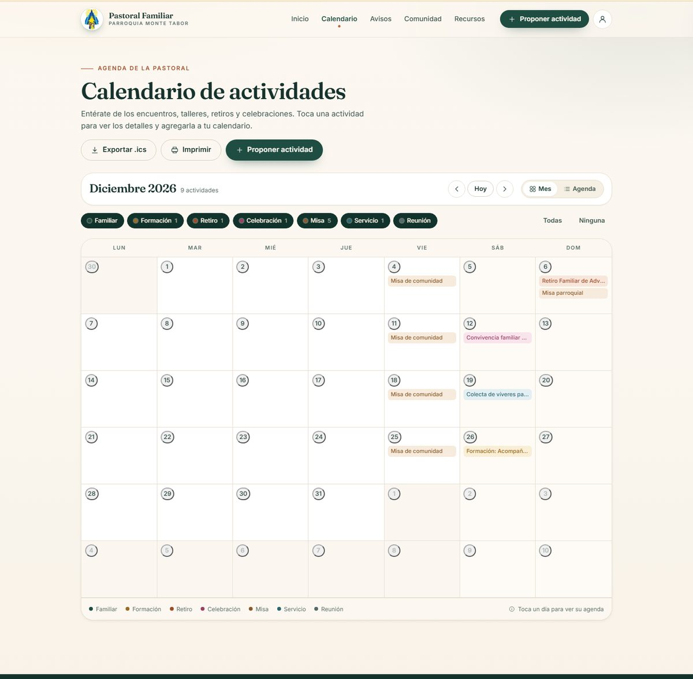
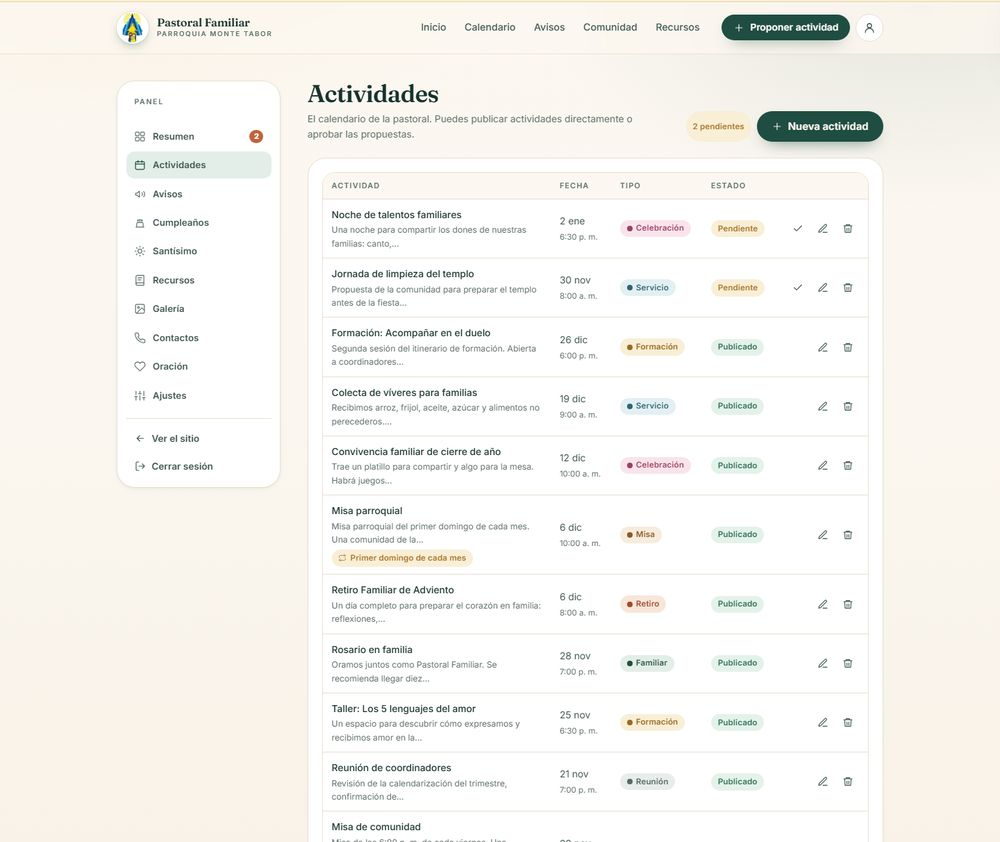
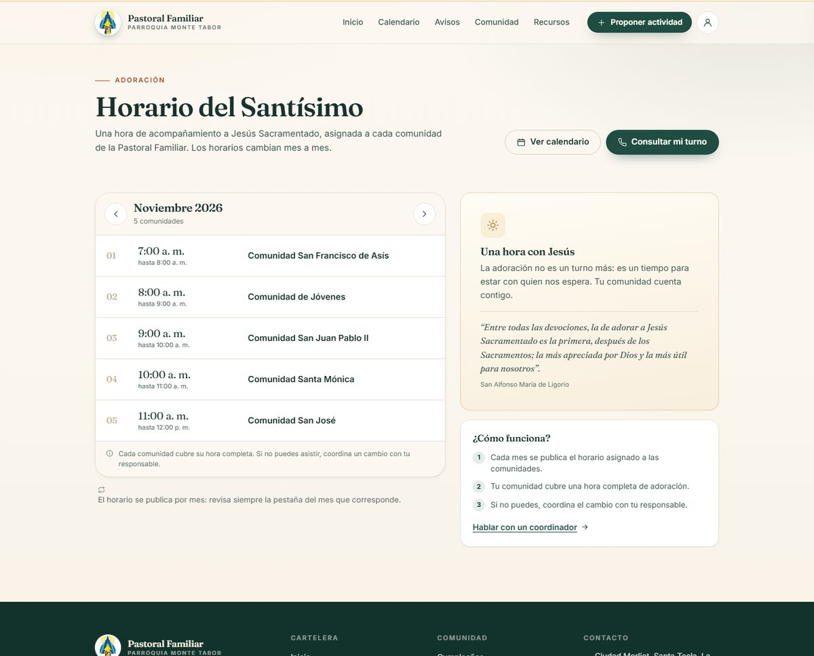
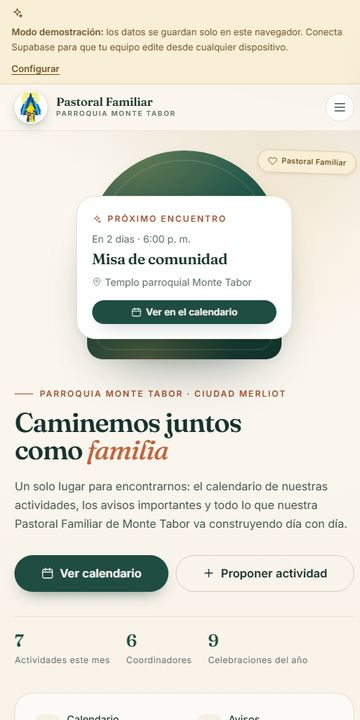

# Cartelera Pastoral Familiar

Sitio web de la **Pastoral Familiar de la Parroquia Monte Tabor**, Ciudad Merliot (Santa Tecla): **calendario de actividades**, avisos, cumpleaños, recursos, galería, contactos, oración y el horario mensual del Santísimo. Varios coordinadores pueden publicar desde su teléfono y los cambios aparecen en la web de todos.

Está hecho con **HTML, CSS y JavaScript puro**, sin compiladores ni dependencias de desarrollo. Se publica tal cual en **GitHub Pages** y, cuando quieres trabajo en equipo, se conecta a **Supabase** (gratis).



---

## Lo que incluye

- **Calendario** con vista de mes y agenda, filtros por tipo de actividad, exportación a `.ics` (Google/Apple Calendar) e impresión.
- **Actividades fijas recurrentes**: la misa de comunidad de cada viernes y la misa parroquial del primer domingo se repiten solas en el calendario, sin duplicarlas mes a mes.
- **Horario del Santísimo**: una hora de adoración por comunidad, organizada mes a mes y editable desde el panel.
- **Avisos** con prioridad, fijados arriba, fecha de vigencia y búsqueda.
- **Cumpleaños y aniversarios** agrupados por mes.
- **Recursos** (documentos, enlaces, formularios, videos) por categoría.
- **Galería** de álbumes con visor de fotos.
- **Directorio de contactos** con llamada, WhatsApp y correo.
- **Oración**: envío de intenciones (públicas o solo para el equipo) y botón “Amén”.
- **Propuesta pública de actividades**: cualquier miembro envía una idea y un coordinador la aprueba.
- **Panel de administración** con acceso, bandeja de aprobación, alta/edición/baja de todo el contenido y ajustes del sitio.
- **Crear desde el calendario**: un coordinador toca un día y agrega la actividad con la fecha ya precargada.
- **Modo demo local**: la web funciona sin configurar nada, guardando los datos en el navegador.
- **Tiempo real** cuando está conectada a Supabase.
- Diseño **responsive**, accesible con teclado y listo para imprimir.

| Calendario | Panel de coordinadores |
| --- | --- |
|  |  |



<p align="center">
  
</p>

---

## Inicio rápido (ver la web en tu computadora)

Los archivos usan módulos de JavaScript, así que necesitan servirse por HTTP (abrir `index.html` con doble clic no funciona en Chrome).

Con Python instalado:

```bash
cd cartelera-pastoral
python -m http.server 8000
```

Abre <http://localhost:8000>.

Alternativas: extensión **Live Server** de VS Code, o cualquier servidor estático.

> La primera vez arranca en **modo demostración** con datos de ejemplo. Puedes entrar al panel con cualquier correo y contraseña. Todo lo que edites se guarda en ese navegador.

---

## Publicarlo en GitHub Pages

1. Crea un repositorio en GitHub (por ejemplo `cartelera-pastoral`).
2. Sube **el contenido** de esta carpeta (no la carpeta completa): `index.html`, `assets/`, `js/`, `docs/`, etc.
3. Entra a **Settings → Pages**.
4. En *Source* elige **Deploy from a branch**, rama `main`, carpeta `/ (root)` y guarda.
5. En uno o dos minutos la web estará en `https://TU-USUARIO.github.io/cartelera-pastoral/`.

Guía detallada, con comandos y solución de problemas: **[docs/GUIA-DESPLIEGUE.md](docs/GUIA-DESPLIEGUE.md)**.

---

## Que el equipo edite desde cualquier dispositivo

GitHub Pages solo sirve archivos estáticos: no puede guardar cambios por sí solo. Para eso está **Supabase**, que aporta base de datos, usuarios y almacenamiento de imágenes en su plan gratuito.

1. Crea un proyecto en <https://supabase.com>.
2. Abre **SQL Editor**, pega el contenido de [`supabase/schema.sql`](supabase/schema.sql) y ejecútalo.
3. Copia la **Project URL** y la **anon public key** en [`js/config.js`](js/config.js).
4. Crea los usuarios de los coordinadores y dale rol de administrador al primero.

Paso a paso con capturas de dónde hacer clic: **[docs/GUIA-SUPABASE.md](docs/GUIA-SUPABASE.md)**.

Mientras `SUPABASE.url` esté vacío, la web sigue funcionando en modo demo sin romperse.

---

## Roles

| Rol | Puede |
| --- | --- |
| Público (sin cuenta) | Ver el sitio, proponer actividades y dejar intenciones de oración. |
| `coordinador` / `editor` | Publicar y editar todo el contenido desde el panel. |
| `admin` | Lo anterior + gestionar perfiles y ajustes. |
| `viewer` | Entra al panel pero solo lectura. |

Cambia el rol de una persona desde Supabase:

```sql
update public.profiles
set role = 'admin'
where id = (select id from auth.users where email = 'correo@ejemplo.org');
```

---

## Personalizar

- **Textos, datos de contacto, redes y secciones visibles**: desde el panel, pestaña **Ajustes**. No hace falta tocar código.
- **Valores por defecto** (nombre, parroquia, frase de portada): [`js/config.js`](js/config.js).
- **Tipos de actividad y colores**: arreglo `CATEGORIES` en `js/config.js`.
- **Actividades recurrentes**: desde el panel, en cada actividad, campo **Se repite** (cada semana o primer domingo de cada mes) y **Comunidad asignada**.
- **Horario del Santísimo**: panel → **Santísimo**, una fila por comunidad y mes.
- **Colores, tipografía y sombras**: variables al inicio de [`assets/css/base.css`](assets/css/base.css).
- **Logo**: el emblema oficial ya está integrado en `assets/img/logo-mark.png`; el archivo original quedó en `logo-oficial.jpg`. Si cambia, reemplaza `logo-mark.png` y `favicon.png`.
- **Contenido inicial de Supabase**: opcional, [`supabase/seed.sql`](supabase/seed.sql).

Más detalles para crecer el proyecto sin romper el calendario: **[docs/PERSONALIZAR.md](docs/PERSONALIZAR.md)**.

---

## Estructura

```
cartelera-pastoral/
├── index.html                 Punto de entrada
├── assets/
│   ├── css/
│   │   ├── base.css           Tokens, tipografía, botones, formularios
│   │   ├── app.css            Cabecera, portada, tarjetas, pie, modales
│   │   ├── calendar.css       Calendario, agenda, impresión
│   │   └── admin.css          Panel de administración
│   └── img/                   Logo y favicon
├── js/
│   ├── config.js              Configuración, categorías, secciones, Supabase
│   ├── store.js               Datos: modo demo y Supabase
│   ├── seed.js                Datos de ejemplo
│   ├── recurrence.js          Reglas de repetición (semanal / primer domingo)
│   ├── ui.js                  Cabecera, pie, modales, toasts
│   ├── cards.js               Tarjetas y detalles reutilizables
│   ├── utils.js               Fechas, formatos, .ics, imágenes
│   ├── icons.js               Iconos SVG
│   ├── router.js              Rutas por hash
│   ├── app.js                 Arranque y navegación
│   └── views/                 Una vista por sección + panel
├── supabase/
│   ├── schema.sql             Tablas, permisos (RLS), realtime, storage
│   └── seed.sql               Contenido inicial opcional
└── docs/                      Guías de despliegue, Supabase y personalización
```

Las vistas se cargan por ruta (`#/calendario`, `#/avisos`, `#/santisimo`, …). Agregar una sección nueva no toca las demás.

---

## Datos por confirmar

Estos datos quedaron como marcadores o con un valor razonable; se pueden cambiar en el panel **Ajustes** o en el contenido:

- [x] **Logo oficial**: integrado en la cabecera, el pie y el favicon.
- [ ] **Hora de la misa parroquial** del primer domingo (por ahora 10:00 a. m.).
- [ ] **Rotación de comunidades** asignadas a cada viernes y a cada primer domingo.
- [ ] **Teléfono y WhatsApp** de la pastoral (se dejaron vacíos para no publicar datos falsos).
- [ ] **Horario del Santísimo** de este mes y de los siguientes (el de ejemplo usa las cinco comunidades y las horas del cartel de septiembre).
- [ ] Nombre y correo de los coordinadores reales en **Contactos**.

---

## Notas de seguridad

- La **anon key** de Supabase es pública por diseño. La protección real está en las políticas RLS incluidas en `schema.sql`: el público solo lee lo aprobado y solo los coordinadores escriben.
- Las propuestas de actividades y las intenciones de oración se guardan como **pendientes** y no se publican hasta que un coordinador las aprueba.
- En modo demo no hay seguridad real: es solo para probar. No publiques datos sensibles en ese modo.
- El formulario público incluye una trampa anti-spam simple. Para grupos grandes, considera activar CAPTCHA en Supabase o moderar con más frecuencia.

---

## Costos

- **GitHub Pages**: gratis para repositorios públicos.
- **Supabase**: plan gratuito suficiente para una pastoral (500 MB de base de datos, 1 GB de archivos, usuarios ilimitados en el plan free). Revisa los límites vigentes en su sitio.

---

Hecho para caminar juntos como familia. Si algo no encaja, se puede cambiar: cada sección está separada para que el calendario siga siendo el centro.
